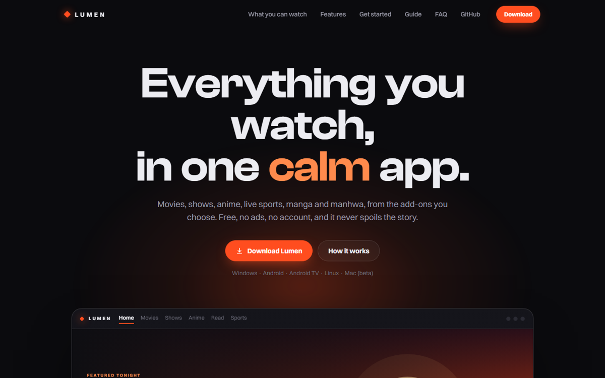
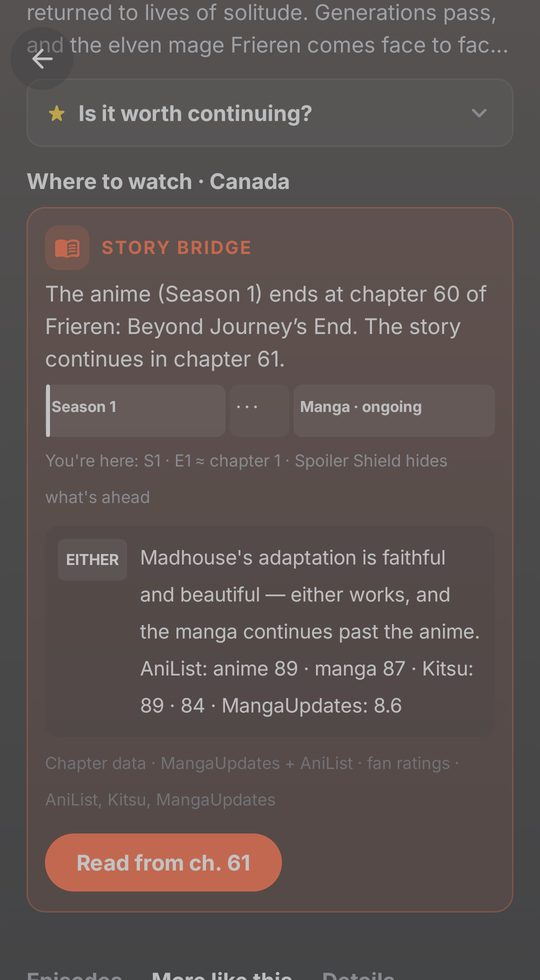
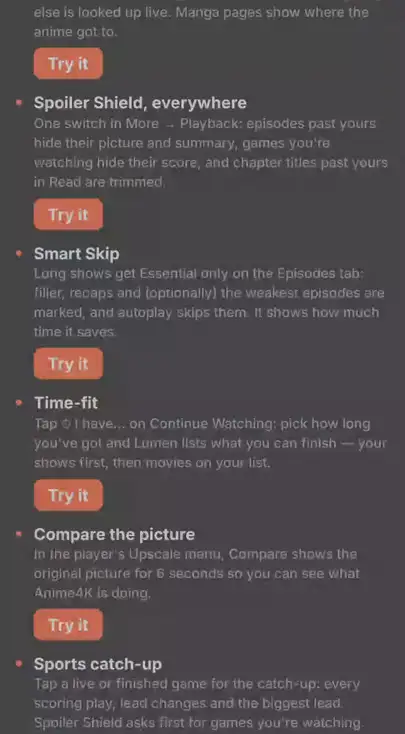
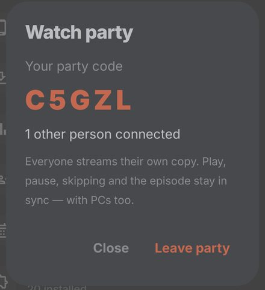

# Lumen

**Knows where you are in every story, never spoils it, and gets you to the good part.**

Movies, shows, anime, live sports, manga and manhwa in one app, from the add-ons you choose. Free, no ads, no account. For Windows, Android, Android TV, Linux and Mac.

[**Download**](#download) · [**Discord**](https://discord.gg/8ntxZ8CMrb) · [**Website**](https://benderjohn513-cpu.github.io/Lumen/) · [**Setup guide**](https://benderjohn513-cpu.github.io/Lumen/guide.html) · [**Add-on packs**](#add-ons-and-add-on-packs) · [**Report a bug**](https://github.com/benderjohn513-cpu/Lumen/issues/new/choose)

---

## Download

| Platform | Download | Notes |
|---|---|---|
| **Windows 10 / 11** (64-bit) | [Lumen for Windows 3.1.0](https://github.com/benderjohn513-cpu/Lumen/releases/latest/download/Lumen-Windows-3.1.0.zip) | Unzip and run `Lumen.exe`. mpv is built in. |
| **Android phones** | [Lumen for Android 3.1.0](https://github.com/benderjohn513-cpu/Lumen/releases/latest/download/Lumen-Android-3.1.0-arm64.apk) | `arm64` APK for most phones from the last 8 years. |
| **Android TV / Google TV** | Same app as phones | `arm64` for most TVs. Older sticks (some Fire TV / Chromecast models) need the `armv7` APK. |
| **Linux** (64-bit) | [Lumen for Linux 3.1.0](https://github.com/benderjohn513-cpu/Lumen/releases/latest/download/Lumen-Linux-3.1.0-x64.tar.xz) | `x64` for most PCs, `arm64` for ARM boards. Extract, run `./lumen`, optionally `./install.sh` for the app menu. Install `mpv` for the best playback. |
| **Mac** (beta) | [Lumen for Mac 3.0.0 beta](https://github.com/benderjohn513-cpu/Lumen/releases/download/v3.0.0/Lumen-Mac-3.0.0-beta-arm64.tar.xz) | `arm64` for Apple-chip Macs (M1 and newer), `x64` for older Intel Macs. Not yet tested on a real Mac. Tell us if it works! |

Other versions (Android armv7, Linux ARM, Mac with Intel) are on the [Releases page](https://github.com/benderjohn513-cpu/Lumen/releases/latest).

### First launch

Lumen isn't code-signed yet, so your device asks once before opening it:

- **Windows:** if you see *"Windows protected your PC"*, click **More info → Run anyway**.
- **Mac:** open it once; if macOS blocks it, go to **System Settings → Privacy & Security** and click **Open Anyway**. If it says the app *"is damaged"*, run `xattr -cr /Applications/Lumen.app` in Terminal.
- **Linux:** nothing to approve. If it won't start, run `./lumen` in a terminal to see why.
- **Android:** allow *"Install unknown apps"* for your browser or file manager when it asks, then open the APK.
- **Android TV:** install with *Downloader* (or any file manager) and allow unknown apps for it.

---

## What makes Lumen different

- **Story Bridge** — Finished an anime? Lumen knows exactly where it stops in the manga — "The anime ends at chapter 60. The story continues in chapter 61" — draws the whole story on one bar with a marker where you are, and opens that chapter for you. It also tells you whether fans rate the anime or the manga higher. Over 1,000 series built in, plus live-action adaptations.
- **Spoiler Shield, everywhere** — One switch. Episodes past yours hide their picture, title and summary; games you're watching hide their score; chapter titles ahead of you are trimmed.
- **Smart Skip** — Long shows get Essential only: filler, recaps and (if you want) the weakest episodes are marked and skipped, and it tells you how many hours that saves.
- **Time-fit** — "I have 45 minutes." Lumen lists what you can finish in that time — shows you're in the middle of first — and plans a binge for you.
- **A better picture** — mpv built in, with automatic quality presets for your hardware and anime upscaling you can switch on. Compare shows the original for a few seconds so you can see the difference.
- **Watch party** — Start a party, send the code. Play, pause, skipping and the episode stay in sync — between PCs, phones and TVs.

### And everything you'd expect

- **One feed, not a pile of add-ons** — rows mix every source (Cinemeta, Kitsu, AniList and your add-ons), and each title shows up once.
- **Anime done properly** — seasonal chart, sub/dub badges, voice cast, filler guides.
- **Read** — manga and manhwa, with downloads, alongside the anime.
- **Sports** — live scores, your teams, and a catch-up of every scoring play when you join late.
- **Pop-out mini player, Chromecast, phone-as-a-remote, Ctrl+K command palette.**
- **Sync** between your PC, phone and TV through your own Google Drive.
- **Episode ratings, Rotten Tomatoes / Metacritic / Letterboxd scores, where-to-watch for your country.**
- **Profiles**, including kids profiles that only show family-friendly titles.

<b>On the phone and TV</b>

 

---

## Add-ons and add-on packs

**Lumen doesn't come with any movies or shows of its own.** Everything you watch comes from *add-ons* — small services, made by other people, that tell Lumen what exists (catalogs and title pages), where to stream it (sources) and what subtitles are available. Lumen uses the same add-ons as Stremio, so if you already use Stremio, Lumen can bring yours straight over.

**New here? An add-on pack is highly recommended.** If you're not coming from another app with add-ons of your own, a pack sets up a full collection in one click:

1. Click a pack link (it looks like `https://benderjohn513-cpu.github.io/Lumen/pack#…`) — it opens in Lumen. You can also paste it into **Add-ons → Packs**.
2. Lumen shows everything in the pack and any warning from whoever made it. Untick anything you don't want.
3. If some add-ons use a service like Real-Debrid, paste **your own** key once — it goes straight into your add-ons on your device and nowhere else.
4. Click **Install**.

**Sharing your own:** *Add-ons → Packs → Share your add-ons* makes one link from your setup. Your keys, accounts and personal settings are stripped out automatically — whoever installs it uses their own, and add-ons tied to your accounts are listed for them to set up themselves. There's also a *free version* switch that leaves out anything needing a paid debrid service.

> Lumen doesn't make, host or check third-party add-ons or the links inside packs. Only install add-ons you trust, and only stream what you have the right to.

---

## FAQ

<b>Is Lumen free?</b>
 Yes. Some add-ons work with paid services (like Real-Debrid), but Lumen itself costs nothing and has no ads.

<b>Does Lumen collect my data?</b>
 No accounts, no analytics. Your history and settings stay on your device. Sync is optional and uses <i>your own</i> Google Drive. Lumen talks to the add-ons you install and to public info services (like AniList, Trakt or MangaUpdates) when you use those features.

<b>Can I bring my add-ons from another app?</b>
 Yes — on Windows, Lumen can pull your add-ons, library and Continue Watching straight from Stremio (nothing in Stremio is changed). You can also paste any add-on's <code>manifest.json</code> link.

<b>Why does Windows or Android warn me when I install it?</b>
 Lumen isn't code-signed (that costs money every year). The warning is the standard one for any unsigned app — see <a href="#first-launch">First launch</a>.

<b>How do I report a bug or ask for a feature?</b>
 <a href="https://github.com/benderjohn513-cpu/Lumen/issues/new/choose">Open an issue</a>. For bugs, say which device and version you're on and what you did right before it happened.

---

## Legal

Lumen is a player. It doesn't host, own, provide or link to any content, and it ships with no streaming add-ons installed. What you watch comes from the add-ons you choose to install, and you're responsible for using add-ons and sources you have the right to use. Lumen isn't affiliated with Stremio, Real-Debrid, AniList, MyAnimeList or any streaming service.

Open-source parts: mpv / libmpv (LGPL), Anime4K shaders (MIT), Inter typeface (SIL OFL 1.1), ExoPlayer / Media3 and Jetpack Compose (Apache 2.0), Tauri (MIT / Apache 2.0).

